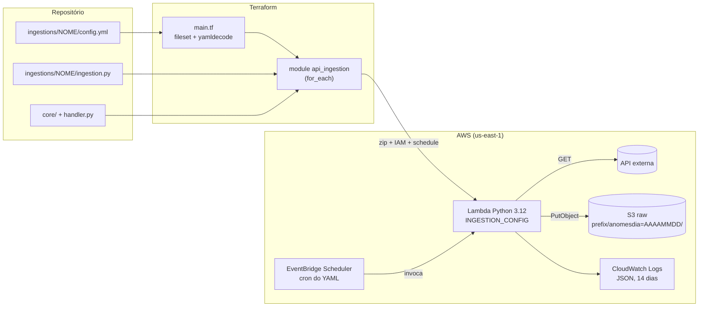

# lambda-api-ingestion

Padrão de **Lambdas de ingestão de APIs dirigido por configuração**, com infraestrutura em Terraform.

Cada ingestão é uma pasta com um `config.yml` e um `ingestion.py`. O Terraform descobre as pastas e cria, para cada uma, uma Lambda agendada que grava os dados brutos no S3, particionados por data. **Novo YAML = nova Lambda no próximo `apply`.**

  

## Objetivo

Em times de dados, cada nova API costuma virar uma Lambda escrita do zero, com cópias do mesmo código de requisição, gravação e logs. Este projeto separa as coisas:

- o que **toda** ingestão faz (requisitar, validar, gravar no S3, logar) fica num `core/` comum;
- o que é **específico** de cada API fica em poucas linhas de `ingestion.py`;
- a **infraestrutura** de cada Lambda (IAM, logs, agendamento) é gerada por um único module Terraform.

Ingestões de exemplo:

| Ingestão | Fonte | Gancho sobrescrito | Agendamento |
|---|---|---|---|
| `cotacao_dolar` | Banco Central (SGS, série 1: dólar PTAX venda) | `transform` (data ISO e valor numérico) | dias úteis, 18h (Brasília) |
| `ibge_ipca` | IBGE Agregados (SIDRA, tabela 1737) | `extract_records` (achata a resposta aninhada) + `transform` | dia 15 de cada mês |

## Arquitetura



Para cada ingestão, o module cria 7 recursos: Lambda, log group, role de execução e sua policy, role do Scheduler e sua policy, e o schedule. O bucket raw é compartilhado, e cada ingestão só tem permissão para gravar no **próprio prefixo**.

## O padrão: core + ganchos + YAML

### Template Method

`core/base_ingestion.py` define a classe `BaseIngestion` com um método `run()` **fixo**, que chama ganchos que as subclasses podem sobrescrever:

```
run()
 ├─ authenticate()          prepara credenciais           (padrão: nenhuma)
 ├─ fetch_pages()           gera as páginas da API        (padrão: um único GET)
 ├─ extract_records(page)   acha os registros na página   (padrão: lista → lista, objeto → [objeto])
 ├─ [sem registros?]        → EmptyResponseError, nada é gravado
 ├─ validate(records)       valida                        (padrão: todo registro é objeto não vazio)
 ├─ transform(records)      ajusta cada registro          (padrão: nenhuma mudança)
 └─ S3Writer.write()        grava no S3                   (sempre feito pelo core)
```

A subclasse decide **o que** cada gancho faz; a classe base decide **quando** cada um roda. Duas regras ficam fora do alcance das subclasses: sem registros a ingestão falha, e a gravação no S3 é sempre do core.

Exemplo real, `ingestions/cotacao_dolar/ingestion.py`:

```python
class Ingestion(BaseIngestion):
    def transform(self, records):
        return [
            {
                "data": datetime.strptime(r["data"], "%d/%m/%Y").date().isoformat(),
                "valor": float(r["valor"]),
            }
            for r in records
        ]
```

### Regra de design

> **Escolha entre opções conhecidas vai no YAML. Lógica vai no `ingestion.py`.**

| No `config.yml` | No `ingestion.py` |
|---|---|
| URL, método, granularidade da partição, agendamento, timeout, memória | achatar uma resposta aninhada, converter tipos, regras de validação |

### Formato do `config.yml`

```yaml
name: cotacao_dolar                # igual ao nome da pasta (snake_case, até 40 caracteres)
description: Dólar PTAX venda (Banco Central, SGS série 1) - últimos 5 dias úteis
api:
  url: https://api.bcb.gov.br/dados/serie/bcdata.sgs.1/dados/ultimos/5?formato=json
  method: GET                      # Fase 1: apenas GET
destination:
  partition: anomesdia             # anomesdia | anomes
  # prefix: opcional, padrão = name
schedule: "cron(0 21 ? * MON-FRI *)"   # EventBridge Scheduler, em UTC
timeout: 30                        # 3 a 300 segundos (opcional, padrão 30)
memory: 128                        # 128 a 1024 MB (opcional, padrão 128)
```

O bucket **não** vai no YAML: o Terraform injeta o bucket raw criado em `terraform/storage.tf`.

### Layout no S3

```
s3://lambda-api-ingestion-raw-<conta>/<prefix>/<partition>=<data>/<name>_<data>.json
```

```
cotacao_dolar/anomesdia=20261017/cotacao_dolar_20261017.json
ibge_ipca/anomes=202610/ibge_ipca_202610.json
```

- **Formato JSON Lines** (um objeto por linha), lido diretamente por Athena e Glue.
- **Idempotente:** o nome do arquivo tem só a data, então reexecutar no mesmo período sobrescreve o arquivo em vez de duplicar dados.
- A partição indica **quando os dados foram coletados**. O período a que cada dado se refere fica nos campos do próprio registro (por exemplo, `data` ou `periodo`).

### Configuração da Lambda

Todas as Lambdas usam o **mesmo** `handler.py`. O que muda é o zip e a variável de ambiente:

```
<nome>.zip
├── handler.py
├── core/*.py
└── ingestion/ingestion.py    ← ingestions/<nome>/ empacotada como pacote "ingestion"
```

O `config.yml` chega à Lambda já convertido em JSON, na variável `INGESTION_CONFIG`.

## Como adicionar uma nova ingestão

1. **Investigue a API.** A resposta é uma lista ou um objeto? Onde estão os registros?
   ```bash
   curl -s "<url>" | python3 -m json.tool
   ```
2. **Crie a pasta** com um nome em snake_case:
   ```bash
   mkdir ingestions/minha_api
   ```
3. **Escreva o `config.yml`** seguindo o formato acima.
4. **Salve uma resposta real** para os testes offline:
   ```bash
   curl -s "<url>" | python3 -m json.tool --no-ensure-ascii > ingestions/minha_api/sample_response.json
   ```
5. **Escreva o `ingestion.py`** começando pelo mínimo. Sobrescreva um gancho só se a API fugir do padrão:
   ```python
   from core.base_ingestion import BaseIngestion


   class Ingestion(BaseIngestion):
       pass
   ```
6. **Rode os testes.** A nova ingestão é descoberta automaticamente:
   ```bash
   .venv/bin/pytest -v -k minha_api            # contrato + amostra (offline)
   .venv/bin/pytest -m live -k minha_api       # contra a API real
   ```
7. **Faça o deploy.** O `plan` deve mostrar 7 recursos novos em `module.ingestion["minha_api"]`:
   ```bash
   cd terraform
   AWS_PROFILE=<perfil> terraform plan -out=tfplan
   AWS_PROFILE=<perfil> terraform apply tfplan
   ```

## Testes locais

Requisitos: Python 3.9 ou superior. A Lambda roda 3.12, mas o código evita sintaxe exclusiva do 3.10+.

```bash
python3 -m venv .venv
.venv/bin/pip install -r requirements-dev.txt

.venv/bin/pytest -v          # testes offline (HTTP e S3 falsos)
.venv/bin/pytest -m live     # chama as APIs reais (requer internet)
```

| Arquivo | O que cobre |
|---|---|
| `tests/test_base_ingestion.py` | ordem dos ganchos, regras de falha (resposta vazia, validação), respostas gzip, montagem da key no S3, ganchos da `cotacao_dolar` |
| `tests/test_ingestions.py` | roda **para cada pasta em `ingestions/`**: contrato do `config.yml`, classe `Ingestion`, `run()` completo com o `sample_response.json` e o teste ao vivo (`-m live`) |

As regras do contrato (formato do nome, `https://`, partições válidas, limites de timeout e memória) também existem como blocos `validation` no module Terraform: o pytest pega o erro na máquina do dev, e o `terraform plan` barra mesmo que os testes sejam pulados.

## Deploy

### Pré-requisitos

- Terraform >= 1.10
- Credenciais AWS num profile local (`AWS_PROFILE`). Não há chaves nem `profile` no código.
- Um bucket S3 existente para o state remoto.

### Primeira vez

```bash
cd terraform
cp backend.hcl.example backend.hcl        # coloque o nome do seu bucket de state (backend.hcl fica fora do Git)
AWS_PROFILE=<perfil> terraform init -backend-config=backend.hcl
```

### A cada mudança

```bash
AWS_PROFILE=<perfil> terraform plan -out=tfplan
AWS_PROFILE=<perfil> terraform apply tfplan
```

Mudou só o código Python? O `source_code_hash` do zip muda e o `plan` mostra a Lambda com atualização in-place. Mudou só uma ingestão? Só os recursos dela aparecem no plan, graças ao `for_each` indexado pelo nome da pasta.

### Invocar manualmente

```bash
aws lambda invoke --function-name api-ingestion-cotacao-dolar --profile <perfil> /dev/stdout
```

### Destruir

```bash
AWS_PROFILE=<perfil> terraform destroy
```

O bucket raw tem `force_destroy = true` (projeto de estudo), então o `destroy` apaga também os dados.

## Estrutura

```
lambda-api-ingestion/
├── core/
│   ├── base_ingestion.py       # BaseIngestion: run() fixo + ganchos
│   ├── s3_writer.py            # key particionada + gravação JSON Lines
│   └── log.py                  # logs estruturados em JSON
├── handler.py                  # entrypoint da Lambda
├── ingestions/
│   ├── cotacao_dolar/          # config.yml + ingestion.py + sample_response.json
│   └── ibge_ipca/
├── terraform/
│   ├── versions.tf             # providers + backend S3 (configuração parcial)
│   ├── providers.tf            # região + default_tags
│   ├── main.tf                 # fileset + yamldecode + module com for_each
│   ├── storage.tf              # bucket raw
│   ├── outputs.tf
│   └── modules/api_ingestion/  # Lambda, IAM, log group, Scheduler, validações
└── tests/
```

## Decisões e aprendizados

- **Só a biblioteca padrão na Lambda** (`urllib`, `json`, `gzip`; o `boto3` já vem no runtime). O zip tem cerca de 5 KB e não há dependências para atualizar.
- **gzip sem pedir:** a API do IBGE às vezes responde com `Content-Encoding: gzip` mesmo quando o cliente pede outra codificação. O `urllib` não descomprime sozinho, então o core passou a tratar isso.
- **Trocar de fonte é barato:** a primeira versão da `cotacao_dolar` usava a AwesomeAPI, que responde `HTTP 429` para chamadas vindas de IPs da AWS. A troca para o Banco Central mudou só o `config.yml` e o `ingestion.py`, sem mexer no core nem no Terraform.
- **Menor privilégio:** cada Lambda só pode `s3:PutObject` em `<bucket>/<prefix>/*` e escrever no próprio log group. A role do Scheduler tem condição `aws:SourceAccount`, contra o problema do "confused deputy".
- **`for_each` em vez de `count`:** cada Lambda é identificada pelo nome da pasta, então remover uma ingestão não recria as outras.
- **arm64 (Graviton):** mais barato, e o código não tem binários nativos.

## Roadmap

- [x] **Fase 1: MVP.** Core com Template Method, uma Lambda por YAML via module + `for_each`, testes de contrato por ingestão.
- [ ] **Fase 2: autenticação e paginação.** `api_key`, `bearer` e `oauth2`; paginação por `page`, `offset` e `cursor`, como tipos prontos no core e escolhidos no YAML.
- [ ] **Fase 3: validação e mais ingestões.** Validação de schema com pydantic (via Lambda Layer) e novas ingestões.
- [ ] **Fase 4: CI/CD.** GitHub Actions com `plan` no pull request e `apply` no merge para a `main`, autenticando na AWS via OIDC (sem chaves armazenadas).
- [ ] **Fase 5: produtividade e operação.** Script de scaffold para criar uma nova ingestão e alertas de falha.
